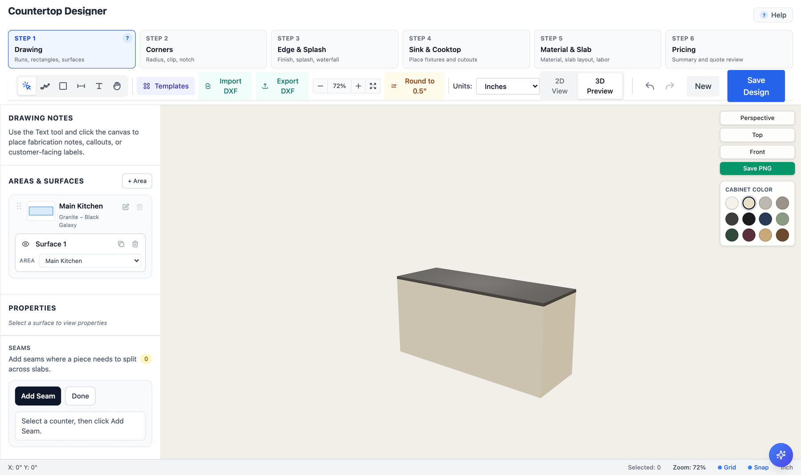
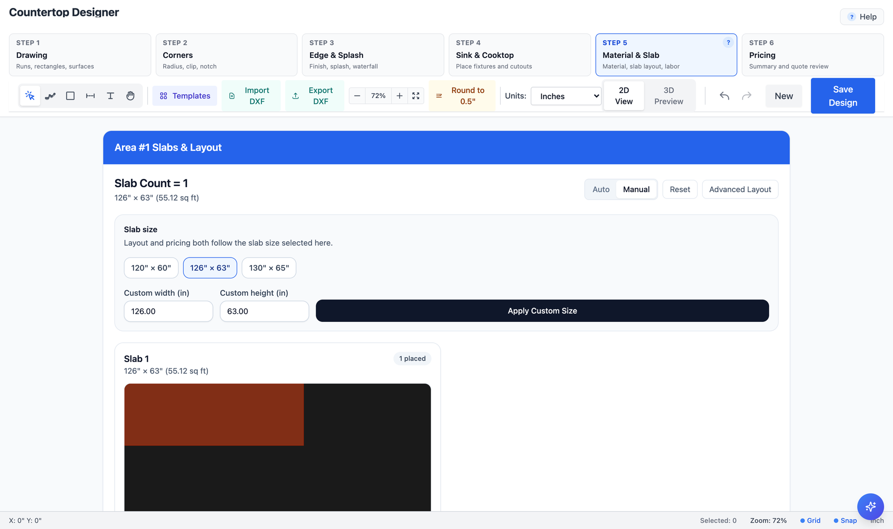
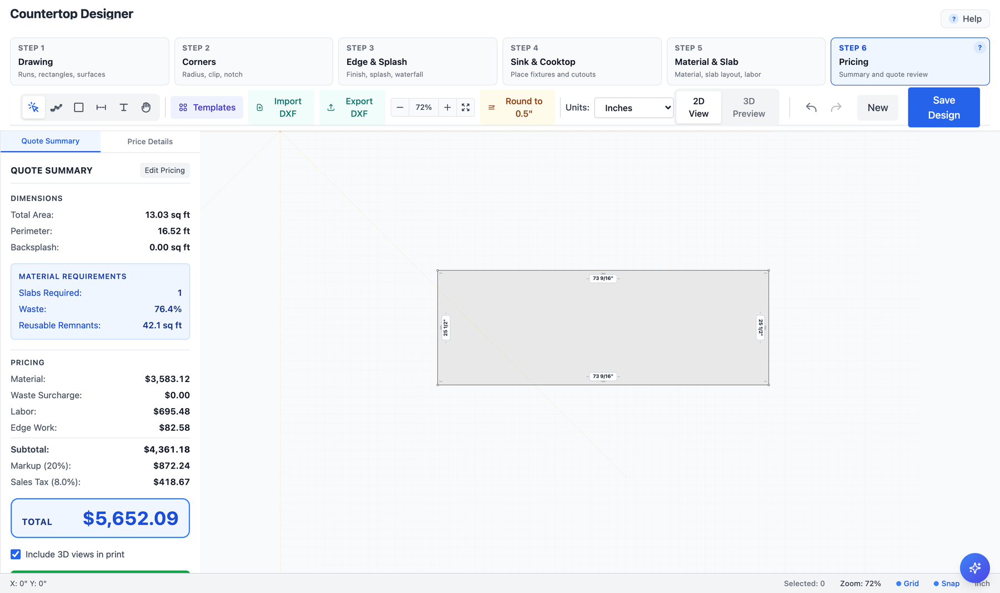
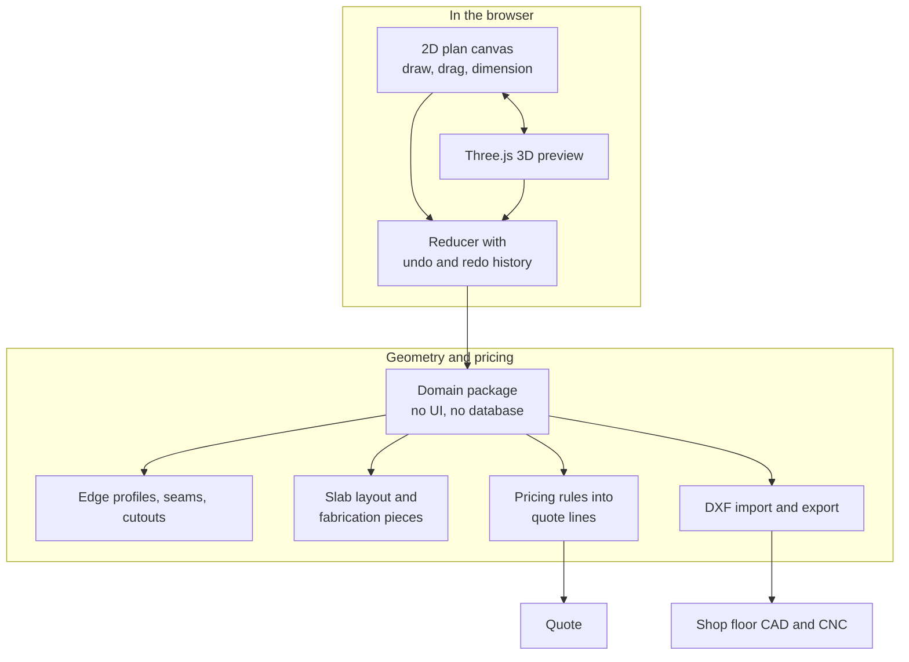

# Xvoria, the countertop designer

Draw a countertop in the browser and watch the price change while you draw it.

Countertop quoting still runs on a tape measure, a sketch, and a phone call two days later. Xvoria lets the fabricator's customer do it themselves: draw the island, cut a hole for the sink, pick a slab and an edge profile, and the price updates as they go.

[xvoria.com](https://xvoria.com)

I build Xvoria with my brother Cihan. This write-up covers my half: the designer, the geometry and pricing engine under it, and DXF in and out. The code is private.

*What the customer sees: the counter in 3D, stone top, cabinet colour, as they draw it.*

*What the shop sees: the same counter nested on a 126 by 63 inch slab, which is where the waste number comes from.*

*What it costs: 13 square feet of counter needs a whole slab, so 76 percent of the stone is waste and 42 square feet of it is a remnant worth keeping. Material, labour, edge work, markup and tax fall out of the cut, not the drawing.*

---

## What the designer does

---

## Notes from building it

### The geometry had to move out of the components

Edge profiles, seam placement, cutout pricing, slab layout, splitting a design into fabrication pieces, mapping those to quote lines. All of it sits in its own package with no React and no database anywhere near it. The 3D view, the API and the PDF generator all call the same functions.

It didn't start that way. It grew inside the component tree, and the moment I wanted to check a price I had to click through the app to get there. Pulling it out meant I could write a test with a known kitchen and a known price.

### One model, two views

The plan view is a flat 2D canvas and the preview is a Three.js scene. Instead of keeping two models in sync, there's one model in plan coordinates and the scene gets rotated so the canvas plane lands on the 3D floor plane. One rotation at the root. Nothing drifts because there's nothing to drift from.

### Nobody in this trade types 3.5

They type `3 1/2"`, or `36 1/4`, or `2'6"`. So dimension input goes through a parser that accepts how a shop actually writes a measurement. A plain decimal field would work fine for me and badly for every person who uses it.

### DXF has to go both directions

The CNC saw and the templating software speak DXF. Exporting isn't enough on its own, because shops already have templates and they want them back in. Supporting import is the difference between fitting into a shop's workflow and asking them to throw it away.

### Undo belongs to the model

Every change goes through a reducer, so history is just a list of past states. I don't write an inverse operation for each tool, and adding a new tool doesn't mean remembering to make it undoable.

### A drawing isn't a cut list

What the customer draws and what the shop cuts are two different things. One L shaped counter might be two slabs with a seam, and where that seam goes depends on what's visible and what's likely to crack. The price follows the cut list, not the drawing. Turning one into the other is where most of the real logic lives, and it's the part that took longest to get right.

---

## Stack

The designer is TypeScript, Three.js and React on Next.js App Router, with Tailwind and Radix for the UI. The domain package is plain TypeScript, nothing else in it. Vitest covers geometry and pricing, Playwright drives the designer end to end, and CI runs typecheck, lint and tests on every push.

The platform around it, auth and customers and quotes and jobs and the multi-tenant backend, is NestJS, Prisma and PostgreSQL, and that part is shared work.
